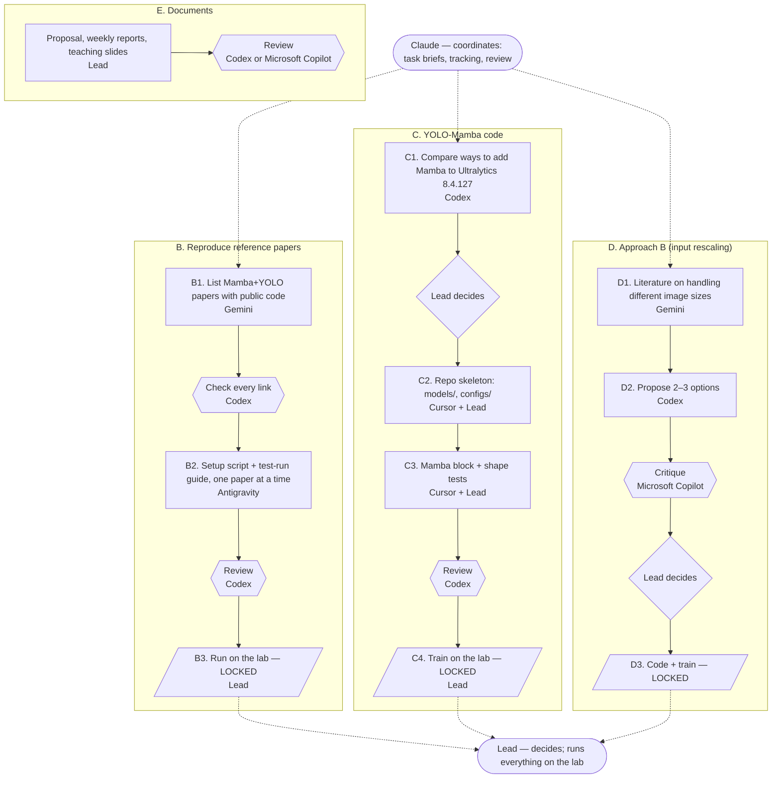

# AGENTS.md — Shared context for all agents

> Every agent (Claude, Antigravity, Cursor, GitHub Copilot, Codex, Gemini, Microsoft Copilot) **must read this file before doing anything**.
> Only the deputy lead (Claude) edits this file, and only after the lead approves.

## 1. Project
- Master's thesis (NTPU, SHAIL Lab) by **Vo Vinh Truong**: pediatric wrist fracture detection on X-ray images.
- Main dataset: **GRAZPEDWRI-DX**, 1 class `fracture`, patient-level split 70/20/10 (seed 42).
- Baseline: **YOLO26** (Ultralytics 8.4.127), `imgsz=640`.
- Two main contributions:
  1. **Integrating Mamba (SSM) into YOLO26** → YOLO-Mamba.
  2. **Approach B — an input-rescaling method**: preserve useful information when X-rays with different native resolutions are downscaled to 640.

## 2. DECIDED — do not change on your own
- Target input size for the main experiments: `imgsz=640`. (`1120` belongs to Approach A and is only a control if the lead decides so.)
- Ablation is **2 × 2** at `imgsz=640`: {with/without rescaling method B} × {with/without Mamba}.
- **Mamba workflow (3 phases):**
  1. Reproduce **every** reference Mamba+YOLO paper that has public code, on GRAZ — goals: learn how others customize YOLO, and get baselines for later comparison. (Results only show "their model on our data"; not directly comparable to YOLO26 because of different Ultralytics versions, pretraining and heads.)
  2. Discuss with the agents to pick candidate Mamba positions.
  3. Try candidates one by one until a suitable position is found; that **one** position is used in the 2 × 2 ablation.
- **Model selection uses the validation set only. The test set is run once, at the very end.**
- The model uses 4 block types: MLP, CNN, Attention, SSM — no RNN.
- Statistics: 3 random seeds; no Wilcoxon test in the current proposal.
- Approach B is a main contribution; in Proposal v2 it is presented as a main contribution only in the Methodology chapter.

## 3. NOT YET DECIDED — agents may only propose (with reasons), never decide
- Where to place Mamba in YOLO26 — candidates are chosen after phase 1 (possible layers: 2, 4, 6, 8, 10, 13, 16, 19, 22 — see `05_Notes/261013.md` §1).
- Whether to add Wilcoxon (or another statistical test), e.g. when comparing Mamba positions whose differences may be smaller than seed-to-seed variation — the lead will discuss with the professor.
- The concrete algorithm for Approach B.
- Epochs/batch size and which machine to use for the full Mamba-YOLO-T training run.

## 4. Current status (updated 2026-10-14)
- YOLO26 baselines n/s/m/l/x: trained (50 epochs, `imgsz=640`).
- Reproducing reference paper **Mamba-YOLO** (#11) on the lab machine: env + CUDA kernel verified; 2-epoch test run in progress.
- Writing **Proposal v2** (`07_Thesis/Proposal/`).
- The latest details are always in the newest note in `05_Notes/`.

## 5. Folder structure
**Lead's Windows machine** — `Desktop\yolo_mamba\`:
```
01_Papers/    papers by topic (A, Basic Models, CNN-VIT, Dataset, Mamba, ...) + Summary.xlsx
02_Dataset/   GRAZ, FracAtlas, MURA (never in git)
03_Code/      ← this git repo (github.com/vovinhtruong/yolo_mamba, private)
04_Results/   result tables (xlsx), charts
05_Notes/     progress notes (YYMMDD.md); older notes in archive/
06_Reports/   weekly report slides
07_Thesis/    Thesis, Draft/, Proposal/
08_Teaching/  teaching slides for new students
09_Agents/    per-agent draft areas: claude/, codex/, gemini/, antigravity/
AGENTS.md     short pointer to this file + write-zone rules
```
**This repo (`03_Code/`)**:
```
scripts/      train/eval/analysis scripts (paths point to the lab machine: ~/VINH_TRUONG/yolo26/)
env_backup/   environment.yml, requirements of the yolo26 env
repos/        (git-ignored) third-party source: ultralytics, mamba, yolo26
```
**Lab machine (`lps_phuong`)**:
```
~/VINH_TRUONG/yolo26/            baseline, dataset/graz, runs/
~/VINH_TRUONG/yolo_mamba/        (contents not yet confirmed — lead to fill in)
~/VINH_TRUONG/mamba_yolo_ref/<PaperName>/env_<PaperName>/   one folder + own env per reference paper
```

## 6. Compute
- `lps_phuong`: 1 × RTX 3080 (~7.9 GB free VRAM), via Cloudflare Tunnel. Main machine.
- `fa_server`: 4 × A40 (48 GB), reached through `lps_phuong`. Borrowed — **check GPU/disk before running**.
- Training runs go in **tmux**; eval/val and other scripts run directly in the terminal.
- **Never write passwords, IPs or tokens into the repo or any project file.**
- **The lab machines are managed by the lead only.** No agent accesses or runs anything on them. Any code or command meant for the lab goes into the repo or `09_Agents/<agent>/` and is **sent to the lead**, who reviews and runs it. Lab outputs (logs, `results.csv`) are copied back by the lead; agents then read and analyse them.
- **No training run starts until the lead says so.**

## 7. Roles (all tools on free plans unless noted)
| Agent | Role | Allowed to |
|---|---|---|
| Lead (human) | Makes every decision, merges into `main` | Everything |
| **Claude** | Deputy lead = **coordinator**: writes task briefs for the other agents, tracks progress, reviews outputs against this file, flags decisions for the lead, keeps the workstreams up to date. Does not do the other agents' work | Edit `AGENTS.md`; write in `09_Agents/claude/` |
| **Antigravity** | Reference papers: reads each paper's repo and prepares the setup script + test-run guide for the lab | Write only in `09_Agents/antigravity/<PaperName>/`; the lead runs it on the lab |
| **Cursor** (Free) | Main IDE: writes the YOLO-Mamba code with the lead, refactoring | Work on its own branch |
| **GitHub Copilot** (Free) | Backup when Cursor runs out of requests; code suggestions for the lead in VS Code | Work on its own branch |
| **Codex** (ChatGPT app) | Critic: challenges ideas and wording, **independently checks Claude's math/logic/analysis**, reviews code/PRs directly in the repo, drafts teaching material | Write only in `09_Agents/codex/`; code changes only on a `codex/<task>` branch via PR |
| **Gemini** (app, chat only) | Reads many papers at once (Notebooks), related work, citation checks | No file access; the lead saves its output in `09_Agents/gemini/` |
| **Microsoft Copilot** | Backup for chat-level review when Codex runs out of quota | Chat only |

Cross-review: work produced by one agent is reviewed by another (e.g. Cursor's code → Codex reviews; Gemini's paper list → Codex checks the links). No agent grades its own work.
When Codex runs out of quota, its tasks simply wait (or use Microsoft Copilot for chat-level review).

Not used: DeepSeek (data-security concerns; Taiwan restricts it in the public sector).

## 8. Write zones — avoiding conflicts
Everyone may **read** everything; each agent **writes** only in its own zone.
| Where | Who writes |
|---|---|
| `09_Agents/<agent>/` (Windows) | That agent only (Gemini's output saved there by the lead) |
| `01_Papers/` … `08_Teaching/` (Windows) | Lead only (Claude only with the lead's approval) |
| `07_Thesis/*.docx` | **Lead only** — Word files cannot be merged; agents put drafts in `09_Agents/` |
| `03_Code/` repo | Via branch `<agent>/<task>` + PR. Claude works in its own cloud clone; Cursor/Copilot/Codex in the Windows copy, one at a time |
| Lab machines (everything: `yolo26/`, `yolo_mamba/`, `mamba_yolo_ref/`, GPU) | **Lead only** — agents send code/commands to the lead |

Lab runs are named `runs/<experiment>_<YYMMDD>` so nothing is overwritten.

## 9. Working rules
1. **Do nothing without the lead's permission.** Push back when there is a real problem or a better way — always with reasons.
2. **Never fabricate numbers or evidence.** Every number must trace back to its source file (`runs/.../results.csv`, logs). Say clearly when unsure; cite sources for outside information.
3. Be concise and focused; work step by step; do not go beyond the assigned scope.
4. **Git:** each agent works on a branch `<agent>/<task>` (e.g. `cursor/fix-eval`), opens a PR → cross-review → the lead merges. Never push directly to `main`.
5. Never commit datasets, weights (`*.pt`), `runs/`, or zip files.
6. Write to `05_Notes/` only when the lead asks; write so that another agent can read it and understand what was done.
7. Keep **actual results** and **expected results** clearly separate when writing the proposal/paper.
8. Never send datasets, unpublished results, or full thesis/proposal text to services outside this team.
9. **Files are reader-facing.** Any agent that produces or renders a file (docx, pptx, pdf, xlsx, figure) must check it before handing it over: it opens with no error or prompt, and has no leftover placeholders, broken numbering, stale table of contents, overflowing text or other visible defects.
10. **No section cross-references in thesis/proposal text** (e.g. "described in Section 3.3.3", "(Section 4.3)"). State the point directly so the reader does not have to look it up.
11. **One document = one file.** Edit the existing file; never save extra copies or new versions (`_v3`, `_new`, …) on your own. If the file is open or locked, ask the lead to close it instead of saving under another name.

## 10. Workstreams
Status lives in the newest note in `05_Notes/`. Edit this diagram (text) when the plan changes — no redrawing needed; GitHub renders it.
LOCKED = waits for the lead's go-ahead. The lab infrastructure is managed by the lead and is not an agent workstream.



| Stream | Doer | Reviewer | Lead decides |
|---|---|---|---|
| B. Reference papers | B1 Gemini; B2 Antigravity | Codex | Paper order; B3 run (LOCKED) |
| C. YOLO-Mamba code | C1 Codex; C2–C3 Cursor + Lead | Codex | C1 choice; C4 train (LOCKED) |
| D. Approach B | D1 Gemini; D2 Codex | Microsoft Copilot | Option; D3 (LOCKED) |
| E. Documents | Lead | Codex / Microsoft Copilot | — |

Suggested order: B1 and D1 in parallel → C1 decision → B2 one paper at a time → C2–C3.
